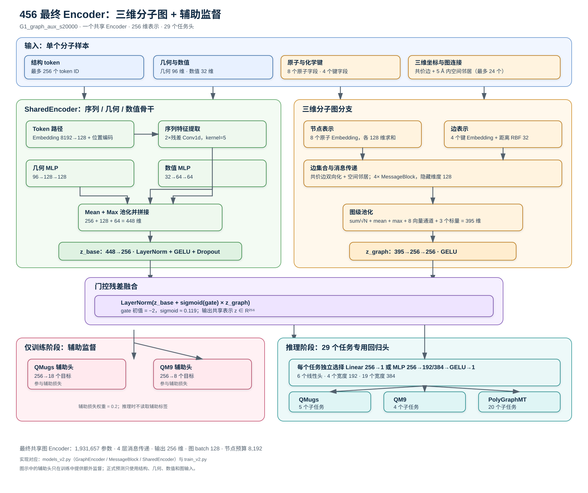

# 456 最终 Encoder 架构图

本图对应最终选中的 `G1_graph_aux_s20000`。它使用一个共享的三维分子图 Encoder，为 QMugs、QM9 和 PolyGraphMT 的 29 个回归子任务产生同一个 256 维分子表示。



## 架构流程

```mermaid
flowchart TB
    IN["单个分子样本<br/>结构 token ≤ 256<br/>几何特征 96 维<br/>数值特征 32 维<br/>原子/键类别与 3D 坐标"]

    subgraph BACKBONE["SharedEncoder：序列、几何与数值骨干"]
        direction LR
        TOK["Token Embedding<br/>8192 → 128<br/>+ Position Embedding"] --> CONV["2 × 残差 Conv1d<br/>depthwise + pointwise<br/>kernel = 5"] --> POOL["Mean Pool + Max Pool<br/>2 × 128 = 256"]
        GEOM["Geometry MLP<br/>96 → 128 → 128"]
        NUM["Numeric MLP<br/>32 → 64 → 64"]
        POOL --> CAT["Concat<br/>256 + 128 + 64 = 448"]
        GEOM --> CAT
        NUM --> CAT
        CAT --> ZBASE["Linear 448 → 256<br/>LayerNorm + GELU + Dropout<br/>z_base ∈ R²⁵⁶"]
    end

    subgraph GRAPH["三维分子图分支"]
        direction TB
        ATOM["8 个原子类别字段<br/>Embedding 各 128 维并求和"]
        BOND["4 个化学键类别字段<br/>Embedding 各 128 维并求和"]
        EDGE["边集合<br/>共价边双向化<br/>+ 3D 空间邻居：半径 5 Å、最多 24 个"]
        DIST["边特征<br/>键 Embedding<br/>+ 32 维距离 RBF<br/>+ has_3d 标志 → 128 维"]
        ATOM --> MSG
        BOND --> DIST
        EDGE --> DIST
        DIST --> MSG["4 × MessageBlock<br/>消息聚合 → 残差更新<br/>LayerNorm + Dropout<br/>隐藏维度 128"]
        MSG --> GP["图级池化<br/>sum/√N + mean + max<br/>8 个向量通道范数<br/>log N + has_3d + graph_valid<br/>395 维"]
        GP --> GPROJ["Graph Projection<br/>395 → 256 → 256<br/>GELU"]
    end

    IN --> TOK
    IN --> GEOM
    IN --> NUM
    IN --> ATOM
    IN --> BOND
    IN --> EDGE
    ZBASE --> FUSE
    GPROJ --> FUSE
    FUSE["门控残差融合<br/>LayerNorm(z_base + sigmoid(gate) × z_graph)<br/>gate 初值 = −2，sigmoid ≈ 0.119<br/><b>共享表示 z ∈ R²⁵⁶</b>"]

    subgraph AUX["仅训练阶段的辅助监督"]
        direction LR
        Z1["共享表示 z"] --> AQ["QMugs 辅助头<br/>256 → 18"]
        Z1 --> A9["QM9 辅助头<br/>256 → 8"]
        AQ --> LOSS["辅助损失权重 0.2"]
        A9 --> LOSS
    end

    subgraph HEADS["推理阶段的任务预测头"]
        direction TB
        Z2["共享表示 z"] --> H["29 个独立回归头<br/>Linear 256 → 1，或<br/>MLP 256 → 192/384 → GELU → 1<br/>按验证集搜索选择"]
        H --> O4["第 4 题：QMugs<br/>5 个子任务"]
        H --> O5["第 5 题：QM9<br/>4 个子任务"]
        H --> O6["第 6 题：PolyGraphMT<br/>20 个子任务"]
    end

    FUSE --> Z1
    FUSE --> Z2

    classDef input fill:#e8f1ff,stroke:#3b6ea8,color:#102a43,stroke-width:1.5px;
    classDef base fill:#eef8ee,stroke:#3c8c4a,color:#173b1a,stroke-width:1.5px;
    classDef graph fill:#fff3df,stroke:#b97818,color:#4a2c05,stroke-width:1.5px;
    classDef fusion fill:#f2eaff,stroke:#7650a8,color:#2b174f,stroke-width:2px;
    classDef head fill:#ffe9ee,stroke:#b34b68,color:#4b1825,stroke-width:1.5px;
    classDef output fill:#e9f7f7,stroke:#258b8b,color:#123c3c,stroke-width:1.5px;
    class IN input;
    class TOK,CONV,POOL,GEOM,NUM,CAT,ZBASE base;
    class ATOM,BOND,EDGE,DIST,MSG,GP,GPROJ graph;
    class FUSE,Z1,Z2 fusion;
    class AQ,A9,LOSS,H head;
    class O4,O5,O6 output;
```

## 如何理解这张图

- **SharedEncoder** 把结构 token、预计算几何描述和数值描述编码成一个基础表示 `z_base`。
- **三维图分支**直接利用原子、化学键和坐标建立图，在共价边之外加入空间邻居，经过 4 层消息传递后得到 `z_graph`。
- **门控残差融合**把两个表示合并为 256 维共享表示。门控参数从较小值开始，使训练初期保留原有骨干的稳定性，再逐步学习图分支的贡献。
- **辅助头**只在训练时使用，帮助表示学习；推理时只需要分子输入，不读取辅助标签。
- **任务头**彼此独立。最终模型中 6 个任务使用线性头，4 个任务使用宽度 192 的 MLP，19 个任务使用宽度 384 的 MLP；所有任务头都接收同一个 256 维 Encoder 输出。

## 规模与实现对应关系

| 部分 | 关键规模 |
|---|---:|
| 共享三维图 Encoder | 1,931,657 个参数 |
| 图消息传递层 | 4 层，隐藏维度 128 |
| 共享输出表示 | 256 维 |
| QMugs 辅助头 | 18 个训练目标 |
| QM9 辅助头 | 8 个训练目标 |
| 主任务头 | 29 个，单头最多 99,073 个参数 |

图中的实现对应 `models_v2.py` 中的 `GraphEncoder`、`MessageBlock` 和 `SharedEncoder`，训练入口对应 `train_v2.py`。
